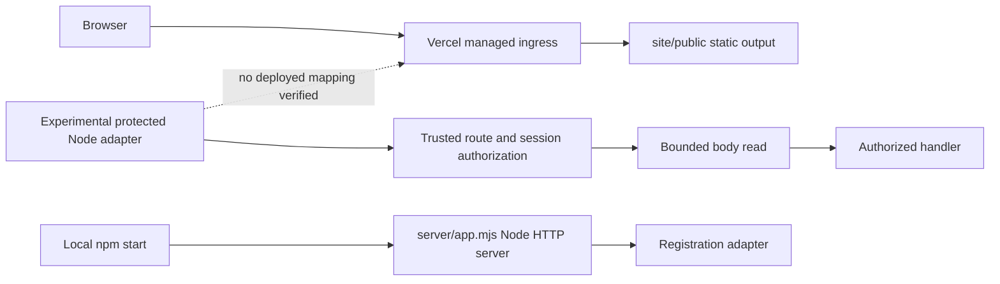

# B487–B495 remediation evidence — 2026-10-21
Status: NO-GO. Baseline: 4f7f9453e2f5764d07f0de96dd6b725cca88587d. Feature branch: work/b391-b398-hosted-identity-certification.

## Verified architecture and route inventory
Connected Vercel project i-way (prj_0vutnbiNCYaxhdrbLfktrsHAvxty), team team_zNHlJbJHa4YZFwN4p9lcHzEH: framework null, Node 24.x, live false. Latest inspected preview dpl_8H6E7pqGReMhrNpHSTBbvG3Gzkj4 is READY at b5a8a60e23382c5db9bb21c7cc28d5b190df004c. READY and deployment type LAMBDAS do not prove any application function exists. SSO protection reports all_except_custom_domains. Environment/database isolation remains unverified.

| Path | Source/runtime | Hosted status |
| --- | --- | --- |
| /, /contact.html, /early-access.html, /privacy.html, /sign-in.html, /support.html, /terms.html, /assets/* | site/public; Vercel static output configuration | Configured assets; endpoint behavior not retested |
| /api/health | server/app.mjs; local Node; no method restriction | No deployed mapping |
| /api/early-access | server/app.mjs; local Node POST | No deployed mapping |
| /api/v1/support/* | server/app.mjs; injected handler, otherwise 503 | No deployed mapping |
| Protected experimental routes | Server-owned registry injected into pipeline; fixture paths are not deployed routes | No api/ entrypoint in complete branch tree |
| Supabase login/callback/refresh/logout | Experimental modules only | Hosted route integration unproven |

vercel.json has no rewrites/redirects/functions and publishes only site/public. npm start is not a Vercel function registration. No application-owned ingress parser is established. Managed header normalization cannot be inspected from these metadata.

Shortest safe staging path: provision/identify an isolated application preview target, confirm approved callback origin and private database role, then connect existing authorization/session components through a supported function entrypoint. Keep the public static project boundary intact. Do not deploy the broad local server as an authentication integration shortcut. Actual identity/session/refresh integration and an approved database path are prerequisites, not satisfied by adding a health endpoint.

## Implemented batch
- Repair B484: use a streamed fetch body and let the client produce framing; fetch rejected the previously supplied Transfer-Encoding header before network I/O.
- Move body consumption into prepareAuthorized, invoked by the existing protected response boundary only after trusted session authorization and before the business handler.
- Preserve native request stream long enough to send rejection; pause and remove reader listeners on limit/error/deadline. Default native read deadline 10 seconds, configurable up to 30 seconds.
- Close rejected HTTP/1 connections; retain generic no-store responses.
- Apply framing validation to GET as well as mutations; reject bodies on GET and duplicate raw critical headers.
- Add ordering, denied/outage/aborted request, oversize, timeout and header regressions.

Changed implementation/test paths:
- server/operations-supabase-bounded-body.experimental.mjs
- server/operations-supabase-node-protected-route.experimental.mjs
- server/operations-supabase-protected-http-response.experimental.mjs
- tests/operations-supabase-real-http-body-limit-experimental.test.mjs
- tests/operations-supabase-body-order-experimental.test.mjs

## Verification
Baseline CI: Identity access certification success (39576827870); Verify failure (39576827910); isolated PostgreSQL failure (39576827732). Both failures identify B484: UND_ERR_INVALID_ARG, invalid transfer-encoding header. Verify baseline: 737/738 tests passed. Earlier PostgreSQL restart/interruption steps passed, later steps were skipped after B484.
Local shell/Git process creation is unavailable (CreateProcessAsUserW access denied; Node child spawn EPERM). Local direct Node assertions passed for authorization denial with zero body reads/handler calls and paused unfinished-stream oversize/timeout. Loopback HTTP returned 413 at 65537 bytes and 200 at 65536 bytes. These are limited direct assertions, not a full local npm verify pass. In-process test-runner attempt timed out and is not counted as a pass.
Reproduce complete tests: npm run verify. Focused: node --test tests/operations-supabase-*.test.mjs.
Implementation commit: eb917f8bf90189696973e23c1bee38579ddb3a1a. Post-change CI passed: [Verify](https://github.com/olu3242/I-WAY/actions/runs/39578013521), [Identity access certification](https://github.com/olu3242/I-WAY/actions/runs/39578013533), [isolated PostgreSQL](https://github.com/olu3242/I-WAY/actions/runs/39578013658). Verify reports 746 passed, 0 failed, 0 skipped; its additional support integration step passes 4/4. Source/build/IP/site checks passed. Isolated PostgreSQL evidence is not hosted Supabase evidence.

## Database and hosted blockers
Project reference vnoxdinldneeczxibicp is pinned by the existing staging configuration. Connected project listing succeeds, but read-only catalog privilege SQL returned permission denial (MCP -32600). No migration or privilege changes attempted; historical PKCE migration restriction remains unresolved. Private table existence/privileges are unverified.
No hosted synthetic sign-in, callback, session persistence/refresh/revocation, four-role tenant isolation, parser-path testing, service interruption, performance comparison or rollback performed. No protected endpoint deployment claimed. No production change or real tester invitations performed.

## Issue register
| Issue ID | Severity | Component | Root cause | Files | Remediation | Test coverage | CI result | Hosted result | Commit | Status |
| --- | --- | --- | --- | --- | --- | --- | --- | --- | --- | --- | --- |
| SEC-487-01 | Critical | Hosted entrypoint | Static output, no protected function mapping | vercel.json; server/start.mjs | Isolated app preview integration required | Hosted suite required | Pending | Blocked | Baseline above | Blocked |
| SEC-488-01 | High | HTTP framing | GET framing and duplicate raw critical headers unchecked | server/operations-supabase-node-protected-route.experimental.mjs | Validate all methods and duplicates | B488 regression | Pass | Not tested | eb917f8bf90189696973e23c1bee38579ddb3a1a | In progress |
| SEC-492-01 | High | Body ordering | Adapter reads before session pipeline | Node adapter; protected HTTP response module | Post-authorization preparation | B492 order/outage/abort | Pass | Not tested | eb917f8bf90189696973e23c1bee38579ddb3a1a | In progress |
| SEC-492-02 | High | Stream lifecycle | Iterator exit can destroy socket; no read deadline | bounded-body module | Native paused reader, timeout, rejection close | Native timeout/oversize + real HTTP | Pass | Not tested | eb917f8bf90189696973e23c1bee38579ddb3a1a | In progress |
| SEC-493-01 | High | CI | fetch forbids manually supplied Transfer-Encoding | real-http-body-limit test | Genuine streamed upload | B484 | Pass | Not applicable to fixture defect | eb917f8bf90189696973e23c1bee38579ddb3a1a | Resolved |
| SEC-490-01 | Critical | Identity/database | Private privileges unavailable; hosted callback/session unproven | Supabase experimental identity modules; db/review-only | Authorized catalog access and reviewed persistence integration required | Hosted identity suite required | Pending | Blocked | Baseline above | Blocked |
| SEC-495-01 | High | Certification | Hosted E2E, rollback and performance evidence missing | This report | Gather on approved isolated deployment | Levels 4–5 | Pending | Blocked | Pending | Blocked |

## Release decision
NO-GO. B487 repository/metadata discovery performed; hosted route behavior remains unverified. B488/B492/B493 implementation has green CI; hosted verification remains absent. B489/B490/B491/B494/B495 acceptance remains incomplete. No production readiness or release authorization inferred.

## Post-commit hosted observations
Vercel Git integration automatically created preview dpl_EFWPg5k1f2H2cMThQXg4qPVwwSqh at implementation commit eb917f8bf90189696973e23c1bee38579ddb3a1a, URL https://i-pxk2orsy4-eduradiusllc.vercel.app. Metadata READY, target null, isRollbackCandidate false. No manual deployment or configuration mutation was issued.
Normal authenticated connector GET checks on that exact preview:
- /: 200, static I-way HTML.
- /api/health: 404, Vercel NOT_FOUND.
- /auth/callback: 404, Vercel NOT_FOUND.
These establish static preview availability and absent tested backend routes, not successful authentication or protected-handler execution. No malformed framing payloads were sent to Vercel.
Project routing API returned routes=[]; branch-filtered environment metadata with decrypt=false returned envs=[] and hiddenProductionEnvCount=0. No values were printed. Environment readiness and isolation cannot be certified from this result.

## Identity contract and migration review
The existing callback orchestration requires state in the query but contains no browser transaction binding. Supabase documents a code callback, not automatic round-tripping of arbitrary application state: https://supabase.com/docs/guides/auth/sessions/pkce-flow. Supabase's maintained admin implementation explicitly excludes PKCE from inviteUserByEmail: https://github.com/supabase/supabase-js/blob/master/packages/core/auth-js/src/GoTrueAdminApi.ts. Do not connect the admin invitation helper directly to this PKCE callback. A supported initiation flow, browser-bound transaction selection and live provider response validation remain required.
The opaque store implements create/get/revoke but no refresh rotation or renewal operation. No hosted token exchange adapter was established. The session tenant bridge checks verified user identity plus an active role; this alone is not evidence of every business permission/relationship/resource-ownership rule.
The existing review-only migration enables and forces RLS and revokes public/client table access, but defines no restricted application role grants/policies. It also uses ON DELETE CASCADE for session user ownership, while repository policy requires deactivation. The PKCE store consumes with DELETE; reconcile ephemeral transaction retention with the no-hard-delete policy before approving a migration. Do not apply this draft as-is or use a superuser workaround. Existing schema, role privileges, grants, retention and migration compatibility require authorized inspection.

Additional open issues:
| Issue ID | Severity | Component | Root cause | Files | Remediation | Test coverage | CI result | Hosted result | Commit | Status |
| --- | --- | --- | --- | --- | --- | --- | --- | --- | --- | --- | --- |
| SEC-490-02 | High | Callback | Custom state and browser binding unintegrated; invitation contract differs | server/operations-supabase-pkce-callback-flow.experimental.mjs; server/operations-supabase-test-invitations.experimental.mjs | Implement verified initiation/callback flow after approved origin/provider setup | Live code exchange, replay, browser binding | Existing mocks pass only | Blocked | eb917f8bf90189696973e23c1bee38579ddb3a1a | Open |
| SEC-490-03 | High | Sessions | No persistent refresh/rotation method | server/operations-supabase-opaque-session-store.experimental.mjs | Atomic rotation with logout/race recovery on verified schema | Refresh/revoke concurrency | Not tested | Blocked | eb917f8bf90189696973e23c1bee38579ddb3a1a | Open |
| SEC-490-04 | High | Migration | Runtime privileges unspecified; retention policy unresolved | db/review-only/iway_private_auth_sessions_b460.sql; server/operations-supabase-pkce-postgres-store.experimental.mjs | Inspect schema; revise reviewed migration with explicit least-privilege and retention policy | Restricted-role PostgreSQL and hosted catalog checks | Not tested | Blocked | eb917f8bf90189696973e23c1bee38579ddb3a1a | Blocked |

## Acceptance status by requested phase
- B487: source/runtime/route inventory and architecture recorded; ordinary preview endpoint observations recorded.
- B488: selected application framing and body defects repaired, CI passed. Full parser matrix and native server timeouts/cancellation remain incomplete.
- B489: ordinary ingress observed; malformed edge/proxy comparison not executed on shared Vercel infrastructure.
- B490: identity contract/schema review performed; operational identity integration blocked and incomplete.
- B491: existing synthetic authorization CI passes; real four-role hosted tenant boundaries and full business authorization not certified.
- B492: authorization-before-body, byte bound, native read deadline, response preservation and raw duplicate checks integrated; full hosted request pipeline not established.
- B493: local limited assertions plus complete feature CI passed. Hosted Levels 4–5 not run. Raw socket smuggling/cancellation matrix remains incomplete.
- B494: automatic static preview inspected; app deployment, environment readiness, restricted DB role, rollback candidate and rollback rehearsal not certified.
- B495: evidence and issue register delivered as an interim NO-GO report, not completed release certification.

## Required external unblock and next batch
Restore authorized read-only catalog access for project vnoxdinldneeczxibicp through the connected Supabase account; do not grant bypass privileges. Provide/confirm an isolated application staging target, approved callback origin and provision server credentials through its secret manager. Resolve the existing migration safety restriction through its approved administrative workflow. Do not paste credentials into chat.
Next batch is B490/B491 application integration against that verified private schema and provider contract, followed by B489/B493 hosted tests and B494 rollback. No operational or performance improvement is claimed without a hosted baseline/comparison. Existing CI tests of database interruption/restart do not certify actual hosted recovery.
