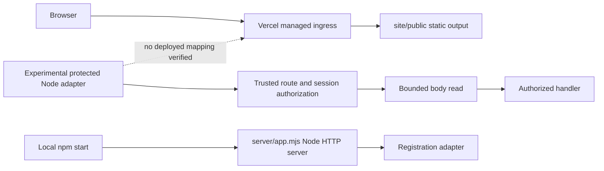

# B487–B495 remediation evidence — 2026-10-21
Status: NO-GO. Baseline: 4f7f9453e2f5764d07f0de96dd6b725cca88587d. Feature branch: work/b391-b398-hosted-identity-certification.

## Verified architecture and route inventory
Connected Vercel project i-way (prj_0vutnbiNCYaxhdrbLfktrsHAvxty), team team_zNHlJbJHa4YZFwN4p9lcHzEH: framework null, Node 24.x, live false. Latest inspected preview dpl_8H6E7pqGReMhrNpHSTBbvG3Gzkj4 is READY at b5a8a60e23382c5db9bb21c7cc28d5b190df004c. READY and deployment type LAMBDAS do not prove any application function exists. SSO protection reports all_except_custom_domains. Environment/database isolation remains unverified.

| Path | Source/runtime | Hosted status |
| --- | --- | --- |
| /, /contact.html, /early-access.html, /privacy.html, /sign-in.html, /support.html, /terms.html, /assets/* | site/public; Vercel static output configuration | Configured assets; endpoint behavior not retested |
| /api/health | server/app.mjs; local Node; no method restriction | No deployed mapping |
| /api/early-access | server/app.mjs; local Node POST | No deployed mapping |
| /api/v1/support/* | server/app.mjs; injected handler, otherwise 503 | No deployed mapping |
| Protected experimental routes | Server-owned registry injected into pipeline; fixture paths are not deployed routes | No api/ entrypoint in complete branch tree |
| Supabase login/callback/refresh/logout | Experimental modules only | Hosted route integration unproven |

vercel.json has no rewrites/redirects/functions and publishes only site/public. npm start is not a Vercel function registration. No application-owned ingress parser is established. Managed header normalization cannot be inspected from these metadata.

Shortest safe staging path: provision/identify an isolated application preview target, confirm approved callback origin and private database role, then connect existing authorization/session components through a supported function entrypoint. Keep the public static project boundary intact. Do not deploy the broad local server as an authentication integration shortcut. Actual identity/session/refresh integration and an approved database path are prerequisites, not satisfied by adding a health endpoint.

## Implemented batch
- Repair B484: use a streamed fetch body and let the client produce framing; fetch rejected the previously supplied Transfer-Encoding header before network I/O.
- Move body consumption into prepareAuthorized, invoked by the existing protected response boundary only after trusted session authorization and before the business handler.
- Preserve native request stream long enough to send rejection; pause and remove reader listeners on limit/error/deadline. Default native read deadline 10 seconds, configurable up to 30 seconds.
- Close rejected HTTP/1 connections; retain generic no-store responses.
- Apply framing validation to GET as well as mutations; reject bodies on GET and duplicate raw critical headers.
- Add ordering, denied/outage/aborted request, oversize, timeout and header regressions.

Changed implementation/test paths:
- server/operations-supabase-bounded-body.experimental.mjs
- server/operations-supabase-node-protected-route.experimental.mjs
- server/operations-supabase-protected-http-response.experimental.mjs
- tests/operations-supabase-real-http-body-limit-experimental.test.mjs
- tests/operations-supabase-body-order-experimental.test.mjs

## Verification
Baseline CI: Identity access certification success (39576827870); Verify failure (39576827910); isolated PostgreSQL failure (39576827732). Both failures identify B484: UND_ERR_INVALID_ARG, invalid transfer-encoding header. Verify baseline: 737/738 tests passed. Earlier PostgreSQL restart/interruption steps passed, later steps were skipped after B484.
Local shell/Git process creation is unavailable (CreateProcessAsUserW access denied; Node child spawn EPERM). Local direct Node assertions passed for authorization denial with zero body reads/handler calls and paused unfinished-stream oversize/timeout. Loopback HTTP returned 413 at 65537 bytes and 200 at 65536 bytes. These are limited direct assertions, not a full local npm verify pass. In-process test-runner attempt timed out and is not counted as a pass.
Reproduce complete tests: npm run verify. Focused: node --test tests/operations-supabase-*.test.mjs.
Post-change CI/commit evidence must be appended after branch update.

## Database and hosted blockers
Project reference vnoxdinldneeczxibicp is pinned by the existing staging configuration. Connected project listing succeeds, but read-only catalog privilege SQL returned permission denial (MCP -32600). No migration or privilege changes attempted; historical PKCE migration restriction remains unresolved. Private table existence/privileges are unverified.
No hosted synthetic sign-in, callback, session persistence/refresh/revocation, four-role tenant isolation, parser-path testing, service interruption, performance comparison or rollback performed. No protected endpoint deployment claimed. No production change or real tester invitations performed.

## Issue register
| Issue ID | Severity | Component | Root cause | Files | Remediation | Test coverage | CI result | Hosted result | Commit | Status |
| --- | --- | --- | --- | --- | --- | --- | --- | --- | --- | --- | --- |
| SEC-487-01 | Critical | Hosted entrypoint | Static output, no protected function mapping | vercel.json; server/start.mjs | Isolated app preview integration required | Hosted suite required | Pending | Blocked | Baseline above | Blocked |
| SEC-488-01 | High | HTTP framing | GET framing and duplicate raw critical headers unchecked | server/operations-supabase-node-protected-route.experimental.mjs | Validate all methods and duplicates | B488 regression | Pending | Not tested | Pending | In progress |
| SEC-492-01 | High | Body ordering | Adapter reads before session pipeline | Node adapter; protected HTTP response module | Post-authorization preparation | B492 order/outage/abort | Pending | Not tested | Pending | In progress |
| SEC-492-02 | High | Stream lifecycle | Iterator exit can destroy socket; no read deadline | bounded-body module | Native paused reader, timeout, rejection close | Native timeout/oversize + real HTTP | Pending | Not tested | Pending | In progress |
| SEC-493-01 | High | CI | fetch forbids manually supplied Transfer-Encoding | real-http-body-limit test | Genuine streamed upload | B484 | Pending | Not tested | Pending | In progress |
| SEC-490-01 | Critical | Identity/database | Private privileges unavailable; hosted callback/session unproven | Supabase experimental identity modules; db/review-only | Authorized catalog access and reviewed persistence integration required | Hosted identity suite required | Pending | Blocked | Baseline above | Blocked |
| SEC-495-01 | High | Certification | Hosted E2E, rollback and performance evidence missing | This report | Gather on approved isolated deployment | Levels 4–5 | Pending | Blocked | Pending | Blocked |

## Release decision
NO-GO. B487 repository/metadata discovery performed; hosted route behavior remains unverified. B488/B492/B493 changes require green CI and hosted verification. B489/B490/B491/B494/B495 acceptance remains incomplete. No production readiness or release authorization inferred.
