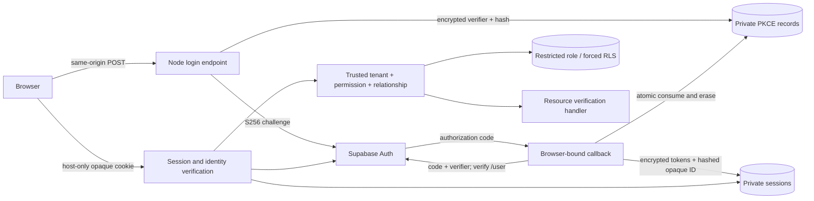

# B490–B495 V2 execution and certification register

**Release: NO-GO.** Repository integration is verified; hosted authentication, database privileges and rollback are not certified. No production deployment, migration application or tester invitation occurred.

Baseline: `8dd8285b85a7a3a68c4b5678946bb7b7232e4f32`. Branch: `work/b391-b398-hosted-identity-certification`. Main workspace brand/site edits were preserved; work used an isolated Git worktree.

## Implementation and scope

One Node request lifecycle now connects login initiation, browser-bound PKCE, pinned Supabase code exchange, independent provider identity verification, encrypted PostgreSQL sessions, refresh claims, private tenant/permission/relationship checks, logout and recovery. A separate packaged Vercel function exposes POST /auth/login, GET /auth/callback, GET /auth/session, POST /auth/refresh, POST /auth/logout, GET /api/health and GET /api/resources/:id/verify.

The selected protected operation is resource-access verification. It returns no business data and cannot mutate operational workflows. Existing local business handlers remain subject to their existing permission/audit checks and are **not newly deployed or hosted-certified by this batch**. A complete four-application hosted operational release remains out of scope of the verified result; its business handlers require their own hosted integration/certification.

## Batch evidence

| Batch | Objective / ten-task checkpoint | Tests passed / failed / skipped | Commit | CI / hosted / next |
| --- | --- | --- | --- | --- |
| B490.1/.4 | Inspect, repair independent binding, generate transaction, harmonize cookie, support code-only callback, reject mismatch, reject replay, test expiry/error, verify, commit/register | focused 72/0/0; full 751/0/0 | `0cbce1cca0476c9c526070e91178d69dc9e18827` | Three workflows green; hosted blocked; proceeded to integration |
| B490.2/.3/.5–B493 | Provider client, verified identity, durable refresh, concurrency/recovery, retained PKCE, restricted migration, resource permissions, Node endpoints, deployment package, CI/register | focused 81/0/0; full 760/0/0; real PG 8/0/0 (parent + 7 subtests) | `12115b821b86c2ce9c13d3c90b1b14c07708908d` | Four workflows green; no hosted provider execution |
| B493–B495 follow-up | Fixation, CSRF, provider mismatch/outage, real PG expiry, browser runner, runner gates, isolated project creation, domain verification, full verification, evidence/register | focused 82/0/0; full 761/0/0; real PG 10/0/0 (parent + 9 subtests) | `02ba5002c3d863a53e80de91b6258e34c1262278` | Four workflows green; no hosted deployment; external prerequisites below |

Release decision for every batch: **NO-GO** for production and tester onboarding.

First-batch CI: [Verify](https://github.com/olu3242/I-WAY/actions/runs/39579511465), [Identity](https://github.com/olu3242/I-WAY/actions/runs/39579511497), [PostgreSQL](https://github.com/olu3242/I-WAY/actions/runs/39579511527).

Integrated-batch CI: [Verify](https://github.com/olu3242/I-WAY/actions/runs/39581541325), [Identity](https://github.com/olu3242/I-WAY/actions/runs/39581541166), [existing PostgreSQL](https://github.com/olu3242/I-WAY/actions/runs/39581541435), [new auth lifecycle PostgreSQL](https://github.com/olu3242/I-WAY/actions/runs/39581541245). All succeeded. Auth lifecycle job 119160078133 also installed the packaged runtime dependencies successfully.

## Security evidence and issue register

| Issue | Repository result | Hosted result |
| --- | --- | --- |
| V2-01 callback query-as-trust defect | Repaired: browser transaction cookie required before consumption/exchange; optional returned state must match; code-only supported | Not run |
| V2-02 inconsistent cookie names | Canonical __Host-iway-session, Secure/HttpOnly/SameSite=Lax/Path=/; duplicate and malformed denied | Not run |
| V2-03 token exchange/identity | Pinned API, bounded response/deadline, independently verified /user; no metadata authority; no uncertain one-time retries | Actual provider exchange unverified |
| V2-04 refresh race | Persistent single-writer claim + compare-and-set, token version, stable opaque handle; losers do not exchange; uncertain result revokes | Real PG fixture passed; hosted unverified |
| V2-05 retention/deactivation | Consumed transaction metadata retained, verifier erased; session tokens erased on revoke/recovery; no DELETE grant; FK RESTRICT | Migration not applied |
| V2-06 resource authority | Four roles, explicit permission, active tenant/membership, fleet and driver relationship checks; platform operational denial | Real PG RLS and HTTP fixture passed; hosted unverified |
| V2-07 runtime registration | Actual packaged api/index.mjs and rewrites; approval/configuration failure returns 503 | No deployment created |
| V2-08 fixation/CSRF/outages | Reauthentication replaces prior handle; wrong-origin/cross-site mutations denied; provider mismatch/outage fails closed | Not run |
| V2-09 privileges | Five forced-RLS tables, nonowner runtime, no DELETE/DDL or role writes, no auth.users read in fixture | Catalog access remains denied |
| V2-10 certification | Real Node+PG CI plus gated real-browser runner | Full certification blocked |

Synthetic repository provider doubles are explicitly **not** Supabase hosted authentication evidence. CI creates its own PostgreSQL 16 fixture and applies review SQL with that fixture's owner; application requests run as iway_auth_runtime. No hosted superuser workaround is used.

Provider contract: [Supabase PKCE](https://supabase.com/docs/guides/auth/sessions/pkce-flow) and [Auth API specification](https://raw.githubusercontent.com/supabase/auth/master/openapi.yaml). The implementation does not rely on arbitrary custom state being returned. Admin invitations are not a PKCE login substitute.

Sessions expire absolutely within one hour; provider access expiry is independently enforced. Rotation does not extend the absolute deadline or create a second browser handle. Claim uncertainty requires reauthentication; logout wins a refresh race. Restart recovery revokes stale claims and preserves unrelated active sessions. Cleanup runs on runtime startup and via explicit store maintenance; an idle deployment requires an approved operational cleanup schedule before a bounded retention SLA can be certified. Encryption key rotation/multi-key rollover is not implemented; replacing the key requires deliberate session invalidation and reauthentication.

## Isolated staging target and external blockers

Created in the user-selected team:
- Team: `team_zNHlJbJHa4YZFwN4p9lcHzEH`.
- Project: `iway-auth-staging`, ID `prj_7uof3CdmN1QvzKxETkXvHjlrLjVm`.
- Assigned domain: `iway-auth-staging.vercel.app`, verified=true in Vercel project domains.
- Node: 24.x. Vercel authentication protection: all deployments. No Git auto-deployment connection was created.
- No application deployment, no environment variables, no secrets configured, no rollback candidate.
- Proposed callback: `https://iway-auth-staging.vercel.app/auth/callback`. Domain ownership/assignment is verified; serving an approved preview and callback registration are not yet verified.
- Supabase target: `vnoxdinldneeczxibicp`.

The read-only private catalog request was denied by Supabase MCP (-32600). Required external action: grant the connected account authorized read-only catalog access for this exact project, review existing grants/policies/role memberships and data compatibility, then separately approve the review-only migration and provision the dedicated runtime role. Do not apply the migration through an owner/superuser workaround.

An authorized administrator must provision reviewed active synthetic tenant/member/resource mappings and a synthetic identity with the selected supported OAuth provider, configure the exact Supabase redirect allowlist, and place the database password, persistent encryption key and provider configuration in the isolated project's secret manager. No real tester account is authorized.

Required runtime configuration names (values must not be pasted into reports): IWAY_AUTH_DATABASE_URL, IWAY_SESSION_ENCRYPTION_KEY, IWAY_SUPABASE_PUBLISHABLE_KEY, IWAY_AUTH_PROVIDER (google/github/azure), IWAY_AUTH_ENABLED, IWAY_AUTH_SCHEMA_APPROVED, IWAY_AUTH_ORIGIN, IWAY_AUTH_APPROVED_ORIGIN, IWAY_STAGING_VERCEL_PROJECT_ID; Vercel supplies VERCEL_ENV and VERCEL_PROJECT_ID. Set enable/schema approval flags only after actual review. The public marketing project is explicitly rejected.

## Execution and rollback runbook

1. Obtain external catalog/role/migration/fixture approvals above. Verify exact project, protected preview environment, provider callback allowlist, secrets availability, CI SHA and schema version.
2. Run `node scripts/package-auth-staging.mjs` in a clean checkout. It requires an empty dist/auth-staging output and copies an explicit runtime dependency graph, public CA, function and lockfiles only. It never packages docs, site, prototype or environment files.
3. Link **dist/auth-staging only** to the exact isolated project. Install with `npm ci --ignore-scripts --omit=dev`. Deploy a protected **preview**, never --prod. The stable callback domain must explicitly resolve to the approved preview; its default production-domain assignment alone is insufficient. Verify routing before enabling auth.
4. Check real /api/health and configuration rejection responses. Do not infer endpoint success from a READY build.
5. Run `node scripts/verify-hosted-auth.mjs` only after setting IWAY_HOSTED_AUTH_APPROVED=true, IWAY_HOSTED_SYNTHETIC_ONLY=true, the exact origin/project above, IWAY_HOSTED_COMMIT as the deployed full SHA, and distinct IWAY_SYNTHETIC_OWN_RESOURCE / IWAY_SYNTHETIC_OTHER_RESOURCE UUIDs. A browser opens for operator sign-in with the approved synthetic account. Deployment protection automation secret, if needed, is scoped only to requests to the approved origin. No provider request receives that secret.
6. The runner checks real callback, cookie protections, replay, session, own-resource handler success, cross-tenant denial, CSRF, refresh, logout and revoked-session denial; it records status/latency only. Optional IWAY_HOSTED_EVIDENCE_PATH is written exclusively, never overwriting evidence. It cannot certify schema privileges, role-revocation faults, operational business handlers, load performance, or rollback by itself.
7. Collect authorized catalog/DB outcomes separately, exercise hosted outage/revocation/recovery, and evaluate latency under an agreed workload. No benchmark/latency SLA is invented here.
8. Record a known-good **preview** deployment ID with the same reviewed schema/config before rehearsing rollback. Route the isolated staging alias back to that immutable preview, verify health/auth/tenant isolation, then restore the tested candidate and repeat. Revoke test sessions as required. Do not roll back by dropping tables or deleting retained metadata. If no working candidate exists, disable auth and keep NO-GO rather than claiming rollback success.

Hosted health/login/session/tenant isolation/performance/recovery/rollback: **NOT RUN**. Local DB recovery is not hosted recovery. No live credential or token values are included in this report.

## Exact changed files from baseline

- `.github/workflows/auth-lifecycle.yml`
- `db/review-only/iway_private_auth_sessions_b460.sql`
- `deploy/auth-staging/api/index.mjs`
- `deploy/auth-staging/vercel.json`
- `docs/security/b490-b495-v2-execution.md`
- `scripts/package-auth-staging.mjs`
- `scripts/verify-hosted-auth.mjs`
- `server/operations-auth-application.mjs`
- `server/operations-auth-authorization.mjs`
- `server/operations-auth-runtime.mjs`
- `server/operations-supabase-auth-callback.experimental.mjs`
- `server/operations-supabase-opaque-session-store.experimental.mjs`
- `server/operations-supabase-pkce-callback-flow.experimental.mjs`
- `server/operations-supabase-pkce-postgres-store.experimental.mjs`
- `server/operations-supabase-pkce-session.experimental.mjs`
- `server/operations-supabase-provider.mjs`
- `server/operations-supabase-session-http-guard.experimental.mjs`
- `tests/local/operations-auth-postgres.test.mjs`
- `tests/operations-auth-authorization.test.mjs`
- `tests/operations-auth-hosted-gates.test.mjs`
- `tests/operations-auth-http.test.mjs`
- `tests/operations-auth-provider.test.mjs`
- `tests/operations-auth-runtime.test.mjs`
- `tests/operations-supabase-body-order-experimental.test.mjs`
- `tests/operations-supabase-browser-binding.test.mjs`
- `tests/operations-supabase-logout-flow-experimental.test.mjs`
- `tests/operations-supabase-node-protected-route-experimental.test.mjs`
- `tests/operations-supabase-pkce-callback-flow-experimental.test.mjs`
- `tests/operations-supabase-protected-route-pipeline-experimental.test.mjs`
- `tests/operations-supabase-real-http-body-limit-experimental.test.mjs`
- `tests/operations-supabase-real-http-fetch-metadata-experimental.test.mjs`
- `tests/operations-supabase-real-http-integration-experimental.test.mjs`
- `tests/operations-supabase-real-http-origin-integration-experimental.test.mjs`
- `tests/operations-supabase-session-http-guard-experimental.test.mjs`

## Final implementation CI receipt

Commit `02ba5002c3d863a53e80de91b6258e34c1262278`: all four workflows succeeded: [Verify](https://github.com/olu3242/I-WAY/actions/runs/39582412594), [Identity](https://github.com/olu3242/I-WAY/actions/runs/39582412603), [existing PostgreSQL](https://github.com/olu3242/I-WAY/actions/runs/39582412619), [auth lifecycle PostgreSQL](https://github.com/olu3242/I-WAY/actions/runs/39582412598). Job 119162956572 recorded focused 82/0/0 and real PostgreSQL 10/0/0, including legacy migration compatibility, no cascading deletion, expiry cleanup and complete HTTP lifecycle. Final local release gate: 761/0/0, all source/build/IP/site checks pass.

This receipt is a documentation-only follow-up to that tested implementation. No hosted success is inferred from these results.
