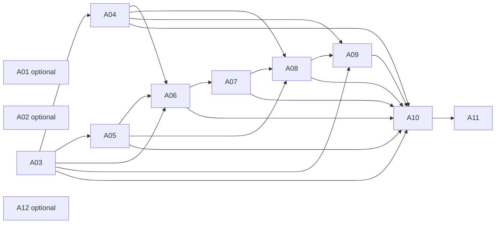

# I-WAY unified activation — current approval register

Starting SHA: `887eeddb33f381733092569fb5d0f2f393b02920`. A01–A12 below retain their exact historical identifiers, targets, dependencies and review procedures from B781–B800. B821–B840 adds explicit owner approval for reviewed feature-branch pushes to PR #21 solely for CI. That publication does not authorize hosted configuration, identity, migration, deployment or access changes. Historical dispositions below the preserved-record boundary remain unchanged.

## Superseding owner finding

The owner confirms that **no exclusive staging PostgreSQL database, authenticated management connection/owner, or invitation provider/sender owner is designated**. `vnoxdinldneeczxibicp` is the public early-access project and is not approved for staging Auth. `yewhurwlsfcrilxpodoo` and `rhcgbiotoxweyqyculvl` belong to unrelated Velocity applications and are excluded. Do not execute historical A03–A09 packages against their previously named database target. Their original text is retained as history, and requires an exact target addendum after designation.

The code currently pins the excluded project in database endpoint validators, issuer/JWKS, provider endpoints and publishable-key validation. Owner designation alone will not make this candidate deployable: one consistent reviewed code/configuration change and rerun of security tests must precede activation. Do not relax validation or replace only a connection URL.

## Current dispositions

| Action | Current exact authorization | Remaining owner decision |
|---|---|---|
| A01 | APPROVED — reviewed B791–B840 feature-branch pushes for CI only | Exact branch `work/b751-b770-harmonization-20261026`, PR #21; no force push, merge or automatic deployment. `c5998b3` published after trigger inspection. Final reviewed SHA and CI recorded in B821 receipt/sidecar. |
| A02 | BLOCKED; optional repair not approved | No current staging Git repair is needed; public mutations are excluded by the latest request. Any new change needs exact owner review. |
| A03 | BLOCKED; old database target is excluded | Project owner designates exclusive staging project, database/version, administrator and private restricted-credential handoff. Review role/grant differences for the actual target. |
| A04 | BLOCKED; no migration execution approved | Database owner reviews broker checksums and rollback against the designated target after A03. |
| A05 | BLOCKED; no migration execution approved | Database owner reviews four ordered Operations migrations plus B662 and per-file transaction recovery against that target. |
| A06 | BLOCKED; 13/13 Preview names observed, values and restricted login not certified; privileged application secret policy unresolved | Vercel owner approves exact project/Preview scope, dedicated DB values, origin and server-only secret channels after consistent target pin remediation. No Production target override. |
| A07 | BLOCKED; no provider change approved | Google/Supabase owner reviews exact client, new provider callback, exact Preview redirect allowlist and password/MFA policy. No wildcard redirects or email-only linking. |
| A08 | BLOCKED; roster approval is not account/privilege approval | Identity/database owners approve actual UUIDs, native principals, permissions, governance namespace, carrier/fleet/employment hierarchy. Two privileged testers enroll their own factors through an approved route. |
| A09 | BLOCKED; delivery service and management process unidentified | Management owner supplies isolated process/connection, metadata schema approval and provider/sender contract. Review one exact approved existing-user issuance/delivery without emitting proofs. |
| A10 | BLOCKED; CI publication approved under A01, deployment prerequisites unsatisfied | Release owner reviews final SHA/archive checksum and genuine protected Preview/project gate after A03–A09 verification. Current code still targets an excluded DB. |
| A11 | BLOCKED; no external invitation or access grant approved | Vercel owner approves exact tester email, commit-specific Preview and expiry/revocation; Hobby permits one active collaborator, so use serial grants. No team membership or bearer links. |
| A12 | BLOCKED; optional public hygiene outside current scope | Separate public-project owner review required in a separately authorized task; no public or Production mutation here. |

Every hosted request must bind the eventual exact database/project, intended diff, prerequisites, owner, risks, validation evidence, rollback, approved candidate SHA and expiry. No partially specified target is ready for approval. The minimum next action is owner designation of the database, authenticated management owner/connection and confidential invitation provider/sender—not blanket approval of all twelve actions.

Current targets: Vercel `prj_7uof3CdmN1QvzKxETkXvHjlrLjVm`, team `team_zNHlJbJHa4YZFwN4p9lcHzEH`, genuine Preview only. Public `prj_0vutnbiNCYaxhdrbLfktrsHAvxty` excluded. Current metadata: staging Git builds disabled, SSO all; public Git builds enabled, main Production branch. Local branch suppression is committed. A01 now permits reviewed pushes for CI only; staging Git deployment creation remains disabled.

[Individually controlled external collaboration](https://vercel.com/docs/deployments/sharing-deployments) requires each external tester to authenticate to their own Vercel account. B821 read-only team metadata confirms Hobby, and the current documentation limits it to one active external collaborator. Prepare serial individual grants only after explicit owner approval. A paid upgrade or concurrent-four plan decision requires a separate owner review and is not performed. No cost quote or commercial-plan eligibility certification is implied.

[Google configuration](https://supabase.com/docs/guides/auth/social-sign-in/auth-google) must bind the actual selected Supabase project callback and exact approved app origin. [TOTP enrollment](https://supabase.com/docs/guides/auth/auth-mfa/totp) requires the human tester to enroll and verify a factor; the current application only challenges existing verified factors. An approved human enrollment route remains a dependency.

## Preserved B781–B800 record

# I-WAY B781–B800 — Approval register

Starting candidate: `6f322e5315dd6846d9d09b6c86efc4f276aeb366`. Source: docs/security/b761-b780-approval-matrix.md, SHA-256 of LF text `3fb3055b6b7658948f15533a1e4fd38041837f7efed6b802d2dc38c54d644013`. All identifiers and original target/change/owner/dependency fields are preserved. No original action has owner approval.

## Already authorized work

- **LOCAL_SOURCE**: Local source and documentation edits; preserve worktree.
- **LOCAL_TESTS**: Disposable PostgreSQL17.11, synthetic authentication, mocked delivery, browser and repository suites.
- **READ_ONLY_HOSTED**: Known-project metadata/catalog and public JWKS observation; no protected application bypass.
- **LOCAL_EVIDENCE**: Secret-safe packages, scans, artifacts and exact-SHA verification.
- **LOCAL_COMMIT**: Reviewed feature-branch commit only; no push/merge/deploy.

The B821 A01 publication addendum above supersedes the historical no-push disposition for the named feature branch only. Other local/read-only permissions do not authorize A02–A12 mutations. Observation of a hosted resource is separate from permission to change it. No generic implementation request is an owner decision.

## Dependency graph

Order expresses prerequisites only. A01/A02/A12 are optional, independent actions. Every mutation remains approval gated.

Validated topological order: A01, A02, A03, A04, A05, A06, A07, A08, A09, A10, A11, A12. An order is not an execution instruction.

## Owner approval required — exact twelve actions

### A01 — Optional

**Status:** BLOCKED_APPROVAL_REQUIRED

**Exact target:** olu3242/I-WAY refs/heads/work/b561-b580-external-uat

**Intended change:** Optional publication of the final local certification commit only; no main merge.

**Responsible owner:** Repository maintainer; Vercel owner for any separate build cancellation

**Dependencies:** None

**Prerequisites:** Separate explicit Git push approval naming final SHA Verify committed branch suppression and both Vercel projects immediately before push

**Security risks:** A push can trigger Git-integrated builds if effective policy differs; local hook is not installed.

**Verification:** Compare advertised ref with approved SHA; inspect both project deployment histories; confirm no Production deployment.

**Rollback:** Stop any unexpected build under owner approval; preserve audit and branch guard; no force-push or reset.

**Decision / exact candidate SHA / expiry:** [TBC]. No action executed.

### A02 — Optional

**Status:** BLOCKED_APPROVAL_REQUIRED

**Exact target:** Vercel team_zNHlJbJHa4YZFwN4p9lcHzEH; staging prj_7uof3CdmN1QvzKxETkXvHjlrLjVm; public prj_0vutnbiNCYaxhdrbLfktrsHAvxty

**Intended change:** Conditional isolation repair only if fresh inspection finds drift: keep staging Git creation/dispatch disabled, staging SSO all, and public branch suppression for work/b561-b580-external-uat. Do not broaden protection or change main.

**Responsible owner:** Vercel project owner

**Dependencies:** None

**Prerequisites:** Fresh whitelisted settings snapshot Approve exact changed settings and previous values; current settings need no mutation

**Security risks:** Incorrect project or branch scope can interrupt public releases or open access.

**Verification:** Re-read both project settings; compare root and isolated vercel.json; verify candidate branch disabled and staging SSO all.

**Rollback:** Restore only the reviewed previous isolation values while retaining protection; stop if restoration would broaden access.

**Decision / exact candidate SHA / expiry:** [TBC]. No action executed.

### A03 — Activation prerequisite

**Status:** BLOCKED_APPROVAL_REQUIRED

**Exact target:** Supabase vnoxdinldneeczxibicp / postgres; iway_auth_runtime, iway_uat_runtime, iway_operations_runtime; optional separate iway_uat_management_runtime

**Intended change:** Credential owner supplies fresh private restricted credentials and creates only approved missing LOGIN roles. Any credential rotation needs separate explicit credential-owner approval.

**Responsible owner:** Database credential owner / authorized database administrator

**Dependencies:** None

**Prerequisites:** Owner attests database target is approved staging and will not modify production/shared production workloads Exact role/grant profile and credential delivery channel approved Plan for zero memberships on broker/Operations/management; managed non-superuser creation may introduce an inbound ADMIN edge

**Security risks:** Managed creator edges can fail strict installation/runtime checks; elevated or reused public/production credentials defeat isolation.

**Verification:** Genuine TLS connections as each role; session_user=current_user=expected role; no administrator SET ROLE Auth B533 allows only its existing bootstrap-granted postgres ADMIN edge with INHERIT=false and SET=false; reject all outbound/other edges Broker/Operations/management require their strict installer and runtime membership checks; unresolved creator edge stays BLOCKED

**Rollback:** Disable activation and revoke candidate sessions; owner may disable new login credentials under separate approval; retain all rows/audit and preserve existing auth edge.

**Decision / exact candidate SHA / expiry:** [TBC]. No action executed.

### A04 — Activation prerequisite

**Status:** BLOCKED_APPROVAL_REQUIRED

**Exact target:** Supabase vnoxdinldneeczxibicp / postgres / iway_uat_private

**Intended change:** Apply only the checksum-bound db/review-only/b631-broker-remediation.sql, then its read-only verifier; do not also apply the older B574 CREATE SCHEMA file.

**Responsible owner:** Authorized staging database administrator

**Dependencies:** A03

**Prerequisites:** A03 broker role and exact membership preflight pass Fresh absence-or-complete-schema catalog, owner snapshot/restore point, SQL hashes approved Local PostgreSQL 17 rehearsal passes; no automatic linked migration command

**Security risks:** Partial schema or unrelated grants fail installation; control metadata spans the roster and must not gain business-table privileges.

**Verification:** Read-only b631-broker-verify.sql; genuine assertUatPostgresRuntime; six FORCE RLS tables, exact grants, schema/client isolation and encrypted proof persistence.

**Rollback:** Failed transaction rolls back; after successful install disable activation and revoke handles/sessions; preserve schema/state/audit. No destructive down migration.

**Decision / exact candidate SHA / expiry:** [TBC]. No action executed.

### A05 — Activation prerequisite

**Status:** BLOCKED_APPROVAL_REQUIRED

**Exact target:** Supabase vnoxdinldneeczxibicp / postgres / operations_private, operations_migrations, operations_engine_private

**Intended change:** Apply the four ordered Operations migrations and then db/review-only/b662-operations-engine.sql exactly as hashed in the migration package; no identity or tenant seeding included.

**Responsible owner:** Authorized staging database administrator

**Dependencies:** A03

**Prerequisites:** A03 Operations role and strict runtime membership conditions satisfied Fresh schema/version/checksum preflight and owner snapshot/restore point Owner confirms no production/shared workload affected; review exact SQL and minimal grants

**Security risks:** Wrong migration order, existing checksum drift, or engine ownership/privilege errors prevent readiness.

**Verification:** Migration checksum ledger; five engine tables ENABLE/FORCE RLS; runtime SELECT only plus state UPDATE(payload,version), audit INSERT; tenant/actor denials and audit rollback.

**Rollback:** Failed transaction rolls back; after success disable candidate activation, revoke candidate sessions and preserve state/audit; restore only via separately approved recovery plan.

**Decision / exact candidate SHA / expiry:** [TBC]. No action executed.

### A06 — Activation prerequisite

**Status:** BLOCKED_APPROVAL_REQUIRED

**Exact target:** Vercel prj_7uof3CdmN1QvzKxETkXvHjlrLjVm Preview only

**Intended change:** Set all 13 names from environment-contract.json using owner-supplied values; DB URLs and encryption key are Secrets. Bind exact approved Preview origin; activation stays off until all gates pass.

**Responsible owner:** Vercel project owner and credential owner

**Dependencies:** A03, A04, A05

**Prerequisites:** A03–A05 verified Exact owner-approved Preview origin and callback registration recorded Private validation of values; no copying legacy DATABASE_URL/service-role/OpenAI credentials Genuine platform VERCEL_ENV=preview and pinned VERCEL_PROJECT_ID, never manual overrides

**Security risks:** Wrong scope/origin, accidental Production target, or privileged credential substitution.

**Verification:** Names/scope listing and private offline contract validation; real restricted login postflight; compare only metadata.

**Rollback:** Disable candidate activation; revoke sessions; remove or restore only reviewed Preview entries without changing Production.

**Decision / exact candidate SHA / expiry:** [TBC]. No action executed.

### A07 — Activation prerequisite

**Status:** BLOCKED_APPROVAL_REQUIRED

**Exact target:** Supabase vnoxdinldneeczxibicp Auth Google/password providers and redirect allowlist

**Intended change:** Approve exact application origin/callback, signup/linking policy and password provider settings. Google Console changes require a separate addendum binding the owner-verified OAuth client ID; no unknown client is authorized here.

**Responsible owner:** Supabase Auth owner; Google OAuth client owner for separately identified addendum

**Dependencies:** A06

**Prerequisites:** Owner privately verifies bound Google OAuth client; actual client ID has not been inspected Google callback https://vnoxdinldneeczxibicp.supabase.co/auth/v1/callback Exact application origin plus /auth/callback approved without wildcard redirects Prevent unapproved signups/automatic linking; verify both methods map to an existing canonical UUID and exact Google subject

**Security risks:** Broad redirects, email-only linking or provider auto-creation can bypass intended identity controls.

**Verification:** Private configuration review, genuine issuer/audience/JWKS validation, state/PKCE tamper/replay denial and fifth-user rejection; hosted execution BLOCKED until approval.

**Rollback:** Disable candidate activation; revoke candidate sessions; restore only reviewed staging provider/redirect settings; preserve identity/audit records.

**Decision / exact candidate SHA / expiry:** [TBC]. No action executed.

### A08 — Activation prerequisite

**Status:** BLOCKED_APPROVAL_REQUIRED

**Exact target:** Supabase vnoxdinldneeczxibicp Auth; four emails in docs/security/uat-provisioning-manifest.json; matching auth and Operations namespaces

**Intended change:** Provision the approved four identities and synthetic carrier/fleet/employment hierarchy only after owner approves exact permissions and recorded IDs. Establish privileged TOTP through a separately approved controlled enrollment flow.

**Responsible owner:** Authorized identity administrator, tenant owner and each tester for own authenticator enrollment

**Dependencies:** A04, A05, A07

**Prerequisites:** Canonical Auth UUID/Google subject/native-principal evidence recorded; no email-only linking Owner-approved platform governance namespace, carrier tenant, child fleet and driver employment IDs Explicit platform/carrier privilege approval and controlled TOTP enrollment route; current app requires pre-enrolled verified factors

**Security risks:** Wrong hierarchy or administrator privileges cause tenant escalation; QR/seed exposure compromises MFA.

**Verification:** Both login methods resolve to one exact canonical identity; platform has no carrier assignment AAL1 denied for platform/carrier; existing verified TOTP challenge yields AAL2; recovery/revocation rechecks membership Fifth-user, wrong fleet, inactive employment and cross-tenant tests deny

**Rollback:** Deactivate memberships/relationships, revoke sessions and invitations, fence broker epochs; no hard-deletion or unapproved administrator creation.

**Decision / exact candidate SHA / expiry:** [TBC]. No action executed.

### A09 — Activation prerequisite

**Status:** BLOCKED_APPROVAL_REQUIRED

**Exact target:** Separate staging management process; Supabase vnoxdinldneeczxibicp; iway_uat_management_private; the four approved recipient emails only

**Intended change:** Activate separately approved B710 metadata schema, pinned existing-user recovery-link issuer and confidential delivery adapter. No privileged management credentials in the application Preview.

**Responsible owner:** Management-service owner, database owner and delivery-provider owner

**Dependencies:** A03, A04, A08

**Prerequisites:** A03 separate metadata role approved if activated Exact management actor UUID/permissions, roster digest, approved origin, operation scope and max-24h owner approval recorded Actual transport account/provider and process identity must be identified before final approval Reconcile any uncertain command before retry; no automatic invitation or account creation

**Security risks:** Ambiguous provider/delivery side effects, privileged credential exposure and accidental duplicate delivery.

**Verification:** Local mocks and PostgreSQL audit/idempotency tests pass; approved live test checks single confidential delivery and canonical user; audit contains metadata only.

**Rollback:** Disable issuance/delivery, revoke outstanding proofs and sessions, retain uncertainty fences and append-only audit; do not resend uncertain commands automatically.

**Decision / exact candidate SHA / expiry:** [TBC]. No action executed.

### A10 — Activation prerequisite

**Status:** BLOCKED_APPROVAL_REQUIRED

**Exact target:** Vercel team_zNHlJbJHa4YZFwN4p9lcHzEH / prj_7uof3CdmN1QvzKxETkXvHjlrLjVm / genuine protected Preview

**Intended change:** Deploy only the exact final commit and artifact checksum bound in dist/b761-b780/post-commit-verification.json; no --prod, promotion, public-project target or Git-push requirement.

**Responsible owner:** Authorized staging release owner

**Dependencies:** A03, A04, A05, A06, A07, A08, A09

**Prerequisites:** A03–A09 verified and explicit exact-SHA/checksum deployment approval Clean committed source, reproducible artifact, delivery verifier PASS/APPROVAL_REQUIRED Fresh SSO all and genuine Preview/project gate checks; do not weaken activation checks

**Security risks:** Wrong output, project or environment can expose the public project or bypass tested gates.

**Verification:** Verify archive SHA/source blobs; protected Preview health, actual runtime identities, bindings and OAuth callback; run hosted matrix only when access is approved.

**Rollback:** Disable candidate activation and revoke sessions; retain previous deployment/evidence; roll back only the isolated candidate under owner approval without Production promotion.

**Decision / exact candidate SHA / expiry:** [TBC]. No action executed.

### A11 — Activation prerequisite

**Status:** BLOCKED_APPROVAL_REQUIRED

**Exact target:** Exact A10 commit-specific protected Preview; the four approved tester emails; Vercel Hobby account eduradiusllc

**Intended change:** Grant one external collaborator at a time on Hobby, revoke and verify denial before the next. Testers use their own Vercel accounts then I-WAY authentication; no team membership or bypass link.

**Responsible owner:** Vercel project owner and UAT owner

**Dependencies:** A10

**Prerequisites:** A10 healthy and protection remains all Exact external account correspondence approved; test schedule and expiry/revocation owner set Concurrent four-tester access requires a separately approved billing change, which is not included in this serial plan

**Security risks:** Overbroad branch/project sharing or lingering grants; Google login alone does not pass Vercel protection.

**Verification:** Individually test platform and application denial for uninvited/fifth user; confirm four personas/tenants; execute 84-case matrix and human scripts without credential capture.

**Rollback:** Revoke individual Vercel grants, app sessions and outstanding invitations; retain SSO protection and audit.

**Decision / exact candidate SHA / expiry:** [TBC]. No action executed.

### A12 — Optional

**Status:** BLOCKED_APPROVAL_REQUIRED

**Exact target:** Vercel public prj_0vutnbiNCYaxhdrbLfktrsHAvxty Preview entries DATABASE_URL, SUPABASE_SERVICE_ROLE_KEY, SUPABASE_DB_PASSWORD

**Intended change:** Optional owner review and removal of unused privileged Preview entries only after dependency confirmation; no Production entry or value is changed by this package.

**Responsible owner:** Public Vercel project owner and credential owner

**Dependencies:** None

**Prerequisites:** Owner verifies public static build/runtime has no dependency on each named Preview entry Approve exact Preview-only changes; confirm scope changes preserve Production configuration No credential values have been read or exposure proven by this names-only audit

**Security risks:** Removing a required legacy value can break a dependent workflow; presence of names alone does not prove browser leakage.

**Verification:** Names/scope inventory after any approved removal; public build/registration preview checks; confirm Production unchanged.

**Rollback:** Owner restores only the reviewed Preview configuration privately; no secret values in Git/evidence.

**Decision / exact candidate SHA / expiry:** [TBC]. No action executed.

## Current release binding addendum

A10’s preserved source text refers to the preceding release verification. Approval of the next candidate must separately bind the exact ending SHA and artifact checksum in dist/b781-b800/post-commit-verification.json. Prior candidate references or signatures cannot authorize this candidate; no signature or approval is present.

Unknown exact Google Console client ID, approved Preview origin, management process/transport account, actor IDs and real hierarchy bindings remain explicit prerequisites. No permission to mutate an unidentified target is requested.

Read-only preparer: `node scripts/check-uat-approvals.mjs`. It validates only the pending source document, fails on changed decisions/IDs/cycles and cannot grant approval, authenticate an owner or execute hosted operations. `buildUnexecutedHostedResults` prepares a new unexecuted run and cannot promote local or historical outcomes to hosted PASS. Genuine future hosted evidence requires its own independently authorized execution and review.
